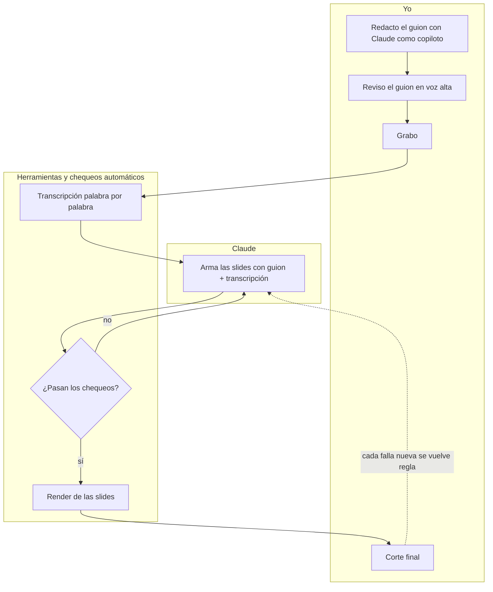

[English](README.md) | [Español](README.es.md)

# Caso de estudio: un pipeline asistido por IA para producir videos de curso

> Este repositorio documenta un caso de estudio, no un producto. El pipeline se construyó como parte de mi trabajo, así que su código, sus prompts y sus reglas internas pertenecen a la empresa donde trabajo y no se publican aquí. Lo que encontrarás es el problema, las decisiones que tomé y lo que aprendí.

## En corto

- **Problema:** una sola persona produciendo una biblioteca grande de videos de curso, con la mayor parte del tiempo dedicada a escribir guiones, armar slides y sincronizarlas a mano con la narración.
- **Qué hice:** diseñé un flujo donde un LLM me ayuda como copiloto a redactar los guiones y arma las slides, chequeos automáticos atrapan sus errores antes de renderizar, y una persona revisa al principio y al final.
- **Resultado:** cada video toma alrededor de un tercio del tiempo que tomaba, hasta 4 veces más videos en el mismo tiempo, y más de 150 videos entregados en 4 cursos desde mayo de 2026.

## Cómo se construyó

Diseñé el flujo y sus reglas, y lo opero. Claude escribió el código; yo lo pruebo, audito lo que produce y dirijo los cambios.

## Contexto

Diseño y produzco cursos en un bootcamp de programación. Todo empezó con un programa autodidacta de capacitación en IA para un cliente corporativo: una biblioteca grande de videos cortos, organizada en niveles de profundidad creciente. Producirlos era trabajo de una sola persona. Desde entonces, el pipeline se ha adaptado a otros cursos.

## Dónde se iba el tiempo

Antes del pipeline, cada video implicaba escribir un guion desde cero, grabar, redactar y diseñar las slides de todo el video, y luego alinear a mano cada slide con el momento en que la decía.

Grabar no era lo lento. Lo lento era escribir el guion y armar y sincronizar las slides.

## Cómo funciona

- Redacto el guion a partir del temario con Claude como copiloto: me ayuda a redactar y yo le doy forma. Después lo leo en voz alta y corrijo lo que no suena natural antes de grabar. Es de las partes más humanas del proceso.
- Después de grabar, el audio se transcribe solo, palabra por palabra, con la hora en que se dice cada una.
- Claude arma las slides con dos insumos: el guion (qué mostrar) y la transcripción (cuándo mostrarlo). En el camino detecta tomas repetidas y corrige los términos que la transcripción suele escuchar mal.
- Antes de renderizar corren chequeos automáticos. Si alguno falla, las slides regresan a corregirse.
- Yo hago el corte final.

## Decisiones clave

1. **Tiempos por palabra.** La regla principal es que nada aparece en pantalla antes de que se diga. Saber cuándo se pronuncia cada palabra permite que cada elemento aparezca justo en ese momento.
2. **Slides como código.** Las slides se renderizan desde código (Remotion), así que son consistentes, se pueden revisar automáticamente y se pueden volver a renderizar cuando algo cambia.
3. **Chequeos, no revisión a ojo.** Un LLM falla en silencio, y una persona revisando frames a ojo se pierde la mayoría de esas fallas.
4. **Personas en los dos extremos.** El guion se revisa en voz alta antes de grabar, y el corte final es mío.

## Resultados

- **Tiempo por video** (guion y edición): alrededor de un tercio de lo que tomaba.
- **Capacidad:** hasta 4 veces más videos en el mismo tiempo.
- **Volumen:** más de 150 videos en 4 cursos desde mayo de 2026.

Son estimaciones a partir de mi ritmo de entregas antes y después del pipeline, no un estudio de tiempos controlado. Por ahora, soy el único usuario.

## Qué falló en el camino

- **Pantalla vacía mientras la narración seguía.** Dos causas distintas se veían idénticas: huecos en los tiempos de las slides, y slides llenadas con nombres de campo que su plantilla no tenía, lo que dibuja una slide vacía sin ningún error. Lo que por fin las distinguió fue mirar el frame real en lugar de teorizar.
- **Términos técnicos mal escuchados.** El reconocimiento de voz escribía "Cloud" en lugar de "Claude", y en un curso de IA eso cambia el sentido de la frase. Se resuelve con una lista de errores conocidos que se aplica al escribir guiones y slides. Las cifras que no cuadran se me marcan para que yo decida; nunca se cambian en silencio.
- **Listas que no se leían bien.** Sincronizar estrictamente palabra por palabra producía slides que pasaban en un par de segundos. Para un curso se ajustó la regla a una slide por idea, y las respuestas a preguntas planteadas en pantalla siguen esperando a que se digan.

## Qué aprendí

1. Un LLM en producción falla en silencio, así que necesita chequeos automáticos, no revisión visual.
2. Cuando algo falla, hay que mirar el resultado real antes de teorizar.
3. Una regla que funciona para un curso puede fallar en otro. Hay que poder ajustarla por caso sin romper el resto.
4. Hoy funciona porque yo lo opero. La siguiente prueba es que alguien más lo use sin mí.

## Herramientas (públicas)

ffmpeg · Whisper · Claude · Remotion (React) · Final Cut Pro

## Sobre mí

Victor Vigueras — educador técnico y desarrollador front-end enfocado en accesibilidad web.
GitHub: [vviguerashd](https://github.com/vviguerashd)
