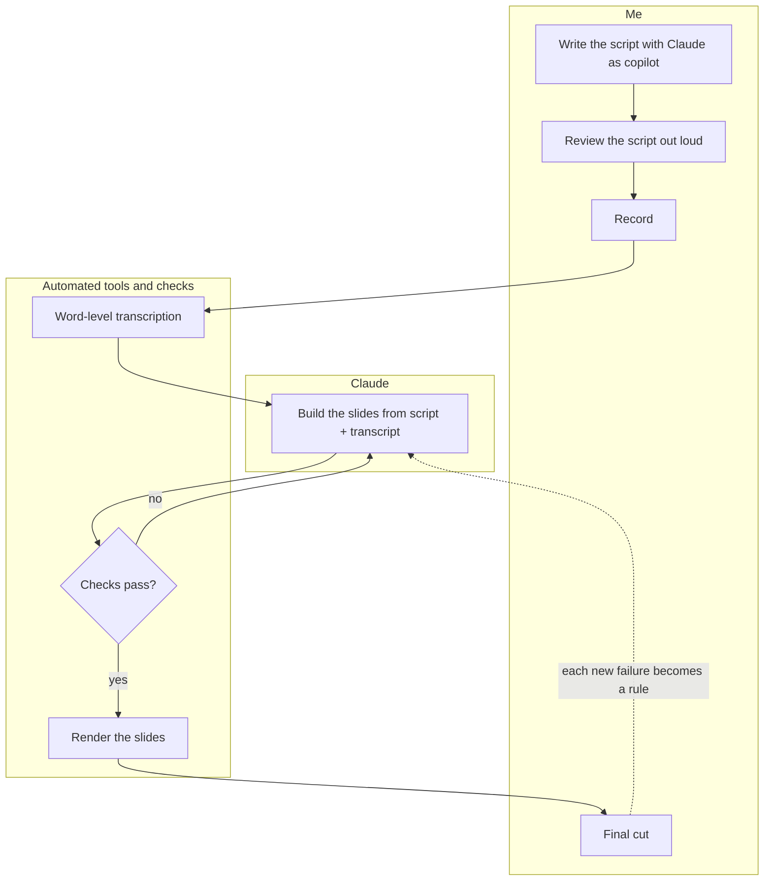

[English](README.md) | [Español](README.es.md)

# Case study: an AI-assisted pipeline for producing course videos

> This repository documents a case study, not a product. The pipeline was built as part of my job, so its code, prompts and internal rules belong to my employer and are not published here. What you'll find is the problem, the decisions I made and what I learned.

## TL;DR

- **Problem:** one person producing a large library of course videos, with most of the time going into writing scripts, building slides and syncing them by hand to the narration.
- **What I did:** designed a workflow where an LLM works as my copilot on the scripts and builds the slides, automated checks catch its mistakes before anything is rendered, and a person reviews at the start and at the end.
- **Result:** each video takes about a third of the time it used to, up to 4x more videos in the same time, and 150+ videos shipped across 4 courses since May 2026.

## How it was built

I designed the workflow and its rules, and I operate it. Claude wrote the code; I test it, audit the output and direct the changes.

## Context

I design and produce courses at a coding bootcamp. It started with a self-paced AI training program for a corporate client: a large library of short videos, organized in levels of increasing depth. Producing them was a one-person job. Since then, the pipeline has been adapted to other courses.

## Where the time went

Before the pipeline, each video meant writing a script from scratch, recording, writing and designing slides for the whole video, and then lining up every slide by hand with the moment I said it.

Recording wasn't the slow part. Writing the script, and building and syncing the slides, were.

## How it works

- I write the script from the syllabus with Claude as a copilot: it helps me draft, and I shape it. Then I read it out loud and fix whatever doesn't sound natural before recording. This is one of the most human parts of the process.
- After recording, the audio is transcribed automatically, word by word, with the time each word is said.
- Claude builds the slides from two inputs: the script (what to show) and the transcript (when to show it). Along the way it detects repeated takes and corrects terms the transcription tends to mishear.
- Automated checks run before rendering. If one fails, the slides go back to be fixed.
- I make the final cut.

## Key decisions

1. **Word-level timing.** The main rule is that nothing appears on screen before it's said. Knowing when each word is spoken lets each item appear exactly then.
2. **Slides as code.** Slides are rendered from code (Remotion), so they are consistent, can be checked automatically and can be re-rendered when something changes.
3. **Checks, not eyeballing.** An LLM fails silently, and a person reviewing frames by eye misses most of those failures.
4. **People at both ends.** The script is reviewed out loud before recording, and the final cut is mine.

## Results

- **Time per video** (script and editing): about a third of what it used to take.
- **Throughput:** up to 4x more videos in the same amount of time.
- **Volume:** 150+ videos across 4 courses since May 2026.

These are estimates based on my delivery pace before and after the pipeline, not a controlled time study. So far, I'm the only user.

## What broke along the way

- **A blank screen while the narration kept going.** Two different causes looked identical: gaps in the slides' timing, and slides filled with field names their template didn't have, which renders an empty slide without any error. What finally told them apart was looking at the actual frame instead of theorizing.
- **Misheard technical terms.** Speech recognition kept writing "Cloud" instead of "Claude", which in a course about AI changes the meaning of a sentence. It's handled with a list of known errors applied when scripts and slides are written. Figures that don't add up are flagged for me to decide, never silently changed.
- **Lists that didn't read well.** Strict word-by-word sync produced slides that flashed by in a couple of seconds. For one course the rule was adjusted to one slide per idea, while answers to questions asked on screen still wait until they're said.

## What I learned

1. An LLM in production fails silently, so it needs automated checks, not a visual review.
2. When something breaks, look at the real output before theorizing.
3. A rule that works for one course can fail in another. You need to be able to adjust it per case without breaking the rest.
4. Today it works because I run it. The next test is someone else using it without me.

## Stack (public tools)

ffmpeg · Whisper · Claude · Remotion (React) · Final Cut Pro

## About me

Victor Vigueras — technical educator and front-end developer focused on web accessibility.
GitHub: [vviguerashd](https://github.com/vviguerashd)
